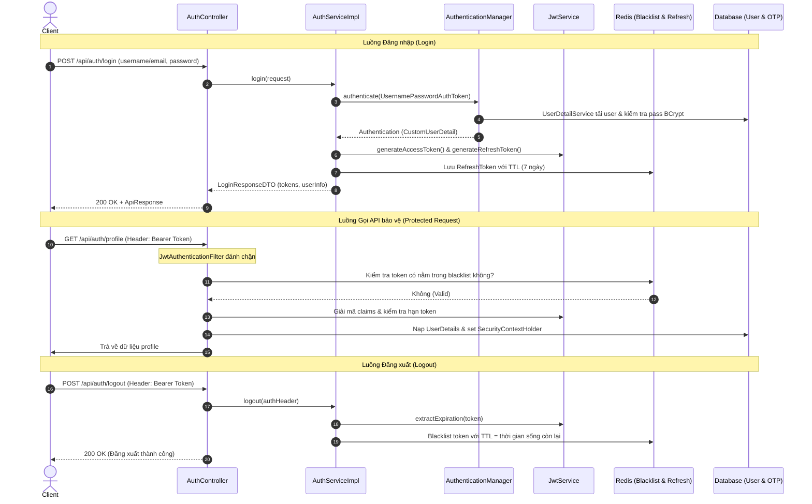

# BỘ KHUNG MẪU AUTHENTICATION & SECURITY (SPRING BOOT 3.x + JWT + REDIS)

> **Tài liệu Context & Boilerplate chuẩn hóa**  
> Dùng làm tài liệu mẫu (Context Template) để tái sử dụng nhanh chóng cho bất kỳ dự án Spring Boot nào cần hệ thống xác thực (Authentication), phân quyền (Authorization), bảo mật JWT Stateless, OTP qua Email và quản lý phiên với Redis.

---

## 1. Tổng quan Kiến trúc (Architecture Overview)

### 1.1. Công nghệ sử dụng
- **Ngôn ngữ & Nền tảng**: Java 17/21, Spring Boot 3.2+ / 3.4+
- **Bảo mật**: Spring Security 6.x (Stateless Session)
- **Token**: JJWT (`io.jsonwebtoken:jjwt-api:0.12.6`)
- **Bộ nhớ đệm & Phiên**: Spring Data Redis (dùng cho Token Blacklist khi Logout và Lưu trữ Refresh Token với TTL)
- **Cơ sở dữ liệu**: Spring Data JPA / Hibernate (PostgreSQL, MySQL, SQL Server)
- **Tài liệu hóa API**: Springdoc OpenAPI v2 (`springdoc-openapi-starter-webmvc-ui:2.8.0`)
- **Công cụ hỗ trợ**: Project Lombok, Jakarta Bean Validation

### 1.2. Sơ đồ luồng dữ liệu (Authentication Flow)



---

## 2. Dependencies & Cấu hình môi trường

### 2.1. Cấu hình `pom.xml` (Maven)

```xml
<properties>
    <java.version>21</java.version>
    <jjwt.version>0.12.6</jjwt.version>
    <springdoc.version>2.8.0</springdoc.version>
</properties>

<dependencies>
    <!-- Spring Boot Starters -->
    <dependency>
        <groupId>org.springframework.boot</groupId>
        <artifactId>spring-boot-starter-web</artifactId>
    </dependency>
    <dependency>
        <groupId>org.springframework.boot</groupId>
        <artifactId>spring-boot-starter-security</artifactId>
    </dependency>
    <dependency>
        <groupId>org.springframework.boot</groupId>
        <artifactId>spring-boot-starter-data-jpa</artifactId>
    </dependency>
    <dependency>
        <groupId>org.springframework.boot</groupId>
        <artifactId>spring-boot-starter-validation</artifactId>
    </dependency>
    <dependency>
        <groupId>org.springframework.boot</groupId>
        <artifactId>spring-boot-starter-mail</artifactId>
    </dependency>
    <dependency>
        <groupId>org.springframework.boot</groupId>
        <artifactId>spring-boot-starter-data-redis</artifactId>
    </dependency>

    <!-- JWT 0.12.6 -->
    <dependency>
        <groupId>io.jsonwebtoken</groupId>
        <artifactId>jjwt-api</artifactId>
        <version>${jjwt.version}</version>
    </dependency>
    <dependency>
        <groupId>io.jsonwebtoken</groupId>
        <artifactId>jjwt-impl</artifactId>
        <version>${jjwt.version}</version>
        <scope>runtime</scope>
    </dependency>
    <dependency>
        <groupId>io.jsonwebtoken</groupId>
        <artifactId>jjwt-jackson</artifactId>
        <version>${jjwt.version}</version>
        <scope>runtime</scope>
    </dependency>

    <!-- Swagger / OpenAPI UI -->
    <dependency>
        <groupId>org.springdoc</groupId>
        <artifactId>springdoc-openapi-starter-webmvc-ui</artifactId>
        <version>${springdoc.version}</version>
    </dependency>

    <!-- Lombok -->
    <dependency>
        <groupId>org.projectlombok</groupId>
        <artifactId>lombok</artifactId>
        <optional>true</optional>
    </dependency>
</dependencies>
```

### 2.2. Cấu hình `application.properties`

```properties
# JWT Configuration
# Chuỗi bí mật phải là Base64-encoded độ dài tối thiểu 256-bit (32 ký tự text trở lên khi base64)
jwt.secret=${JWT_SECRET:c3VwZXJzZWNyZXRqd3RzZWNyZXRrZXlmb3JwcmludGh1YjNkeXl5eXl5eXl5eXl5eXl5eXl5}
# Access token: 15 phút = 900.000 ms
jwt.access-token-expiration=900000
# Refresh token: 7 ngày = 604.800.000 ms
jwt.refresh-token-expiration=604800000

# Redis Configuration
spring.data.redis.host=${REDIS_HOST:localhost}
spring.data.redis.port=${REDIS_PORT:6379}
# spring.data.redis.password=${REDIS_PASSWORD:}

# CORS Configuration (phân cách bằng dấu phẩy)
app.cors.allowed-origins=${CORS_ALLOWED_ORIGINS:http://localhost:3000,http://localhost:5173}

# Swagger UI
springdoc.api-docs.path=/v3/api-docs
springdoc.swagger-ui.path=/swagger-ui.html
springdoc.swagger-ui.enabled=true
```

---

## 3. Cấu trúc thư mục chuẩn (Package Structure)

```text
src/main/java/com/{your_company}/{project_name}/
├── common/
│   ├── config/
│   │   ├── SecurityConfig.java         # Cấu hình SecurityFilterChain, CORS, PasswordEncoder
│   │   ├── SecurityConstants.java      # URL Whitelist công khai
│   │   ├── SwaggerConfig.java          # Cấu hình OpenAPI + Bearer Authentication
│   │   └── WebConfig.java              # Cấu hình static resource / web mvc
│   ├── infrastructure/
│   │   └── BaseEntity.java             # ID UUID, createdAt, updatedAt
│   ├── response/
│   │   └── ApiResponse.java            # Format JSON response chuẩn hóa
│   ├── security/
│   │   ├── CustomUserDetail.java       # UserDetails adapter
│   │   ├── JwtAuthenticationFilter.java# Filter đánh chặn & kiểm tra blacklist
│   │   ├── JwtProperties.java          # Binding properties jwt.*
│   │   ├── JwtService.java             # Sinh, giải mã, validate JWT (JJWT 0.12+)
│   │   ├── TokenBlacklistService.java  # Quản lý Blacklist trên Redis
│   │   └── UserDetailService.java      # Tìm user nạp vào Spring Security
│   └── util/
│       └── SecurityUtils.java          # Helper lấy user hiện tại từ SecurityContext
├── controller/
│   ├── api/
│   │   └── AuthAPI.java                # Interface khai báo OpenAPI doc
│   └── AuthController.java             # REST Controller xử lý endpoint
├── dto/
│   └── authen/
│       ├── LoginRequestDTO.java
│       ├── LoginResponseDTO.java
│       ├── RegisterRequestDTO.java
│       ├── RegisterResponseDTO.java
│       ├── VerifyOTPRequestDTO.java
│       ├── ForgotPasswordRequestDTO.java
│       ├── ForgotPasswordResponseDTO.java
│       ├── ResetPasswordRequestDTO.java
│       ├── ResetPasswordResponseDTO.java
│       ├── ProfileDTO.java
│       ├── AdminUserResponseDTO.java
│       ├── UpdateUserLockRequestDTO.java
│       └── UpdateUserRoleRequestDTO.java
├── entity/
│   ├── Enumeration/
│   │   └── UserRole.java               # Enum vai trò: ADMIN, USER
│   ├── OTP.java                        # Bảng OTP lưu mã xác thực
│   ├── RefreshTokenRedis.java          # Redis Hash lưu Refresh Token
│   └── User.java                       # Entity User (tối giản đủ cho Auth)
├── repository/
│   ├── OTPRepository.java
│   ├── RefreshTokenRedisRepository.java
│   └── UserRepository.java
└── service/
    ├── AuthService.java
    ├── MailService.java
    └── impl/
        └── AuthServiceImpl.java
```

---

## 4. Chi tiết Source Code mẫu

### 4.1. Entity, Enum & BaseEntity

#### `BaseEntity.java`
```java
package com.example.project.common.infrastructure;

import jakarta.persistence.*;
import lombok.*;
import lombok.experimental.SuperBuilder;
import org.hibernate.annotations.UuidGenerator;
import org.springframework.data.annotation.CreatedDate;
import org.springframework.data.annotation.LastModifiedDate;
import org.springframework.data.jpa.domain.support.AuditingEntityListener;

import java.time.LocalDateTime;
import java.util.UUID;

@Getter
@Setter
@NoArgsConstructor
@AllArgsConstructor
@MappedSuperclass
@SuperBuilder
@EntityListeners(AuditingEntityListener.class)
@EqualsAndHashCode(onlyExplicitlyIncluded = true)
public abstract class BaseEntity {

    @Id
    @GeneratedValue
    @UuidGenerator
    @Column(name = "id", nullable = false)
    @EqualsAndHashCode.Include
    private UUID id;

    @CreatedDate
    @Column(name = "created_at", updatable = false)
    private LocalDateTime createdAt;

    @LastModifiedDate
    @Column(name = "updated_at")
    private LocalDateTime updatedAt;

    @PrePersist
    protected void onCreate() {
        if (createdAt == null) createdAt = LocalDateTime.now();
        if (updatedAt == null) updatedAt = LocalDateTime.now();
    }

    @PreUpdate
    protected void onUpdate() {
        updatedAt = LocalDateTime.now();
    }
}
```

#### `UserRole.java`
```java
package com.example.project.entity.Enumeration;

public enum UserRole {
    ADMIN,
    USER
}
```

#### `User.java` *(Tối giản tinh gọn chỉ cho Auth)*
```java
package com.example.project.entity;

import com.example.project.common.infrastructure.BaseEntity;
import com.example.project.entity.Enumeration.UserRole;
import jakarta.persistence.*;
import lombok.*;
import lombok.experimental.SuperBuilder;

@Entity
@Table(name = "users")
@Getter
@Setter
@AllArgsConstructor
@NoArgsConstructor
@SuperBuilder
@EqualsAndHashCode(callSuper = false)
public class User extends BaseEntity {

    @Enumerated(EnumType.STRING)
    @Column(name = "role", nullable = false)
    private UserRole role;

    @Column(name = "username", unique = true, nullable = false, length = 255)
    private String username;

    @Column(name = "email", unique = true, nullable = false)
    private String email;

    @Column(name = "password", nullable = false)
    private String password;

    @Column(name = "full_name", length = 255)
    private String fullName;

    @Column(name = "phone", unique = true)
    private String phone;

    @Column(name = "address", length = 255)
    private String address;

    @Column(name = "is_active", nullable = false)
    @Builder.Default
    private Boolean isActive = true;
}
```

#### `OTP.java`
```java
package com.example.project.entity;

import jakarta.persistence.*;
import lombok.*;
import org.hibernate.annotations.UuidGenerator;

import java.time.Instant;
import java.util.UUID;

@Entity
@Table(name = "otps")
@Getter
@Setter
@AllArgsConstructor
@NoArgsConstructor
@Builder
public class OTP {
    @Id
    @GeneratedValue
    @UuidGenerator
    private UUID id;

    @Column(nullable = false)
    private String email;

    @Column(name = "otp_code", nullable = false)
    private String otpCode;

    @Column(name = "expiry_time", nullable = false)
    private Instant expiryTime;
}
```

#### `RefreshTokenRedis.java`
```java
package com.example.project.entity;

import lombok.AllArgsConstructor;
import lombok.Builder;
import lombok.Data;
import lombok.NoArgsConstructor;
import org.springframework.data.annotation.Id;
import org.springframework.data.redis.core.RedisHash;
import org.springframework.data.redis.core.TimeToLive;

import java.util.UUID;

@Data
@Builder
@NoArgsConstructor
@AllArgsConstructor
@RedisHash("RefreshToken")
public class RefreshTokenRedis {

    @Id
    private String token; // Chuỗi refresh token làm key Redis

    private UUID userId;
    private String email;

    @TimeToLive
    private long ttlInSeconds; // Redis tự động hủy sau TTL
}
```

---

### 4.2. Repositories

#### `UserRepository.java`
```java
package com.example.project.repository;

import com.example.project.entity.User;
import org.springframework.data.jpa.repository.JpaRepository;
import org.springframework.stereotype.Repository;

import java.util.Optional;
import java.util.UUID;

@Repository
public interface UserRepository extends JpaRepository<User, UUID> {
    Optional<User> findByEmail(String email);
    Optional<User> findByUsername(String username);
    Optional<User> findByEmailOrUsername(String email, String username);
    Optional<User> findByPhone(String phone);
    boolean existsByEmail(String email);
    boolean existsByUsername(String username);
}
```

#### `OTPRepository.java`
```java
package com.example.project.repository;

import com.example.project.entity.OTP;
import org.springframework.data.jpa.repository.JpaRepository;
import org.springframework.stereotype.Repository;

import java.util.Optional;
import java.util.UUID;

@Repository
public interface OTPRepository extends JpaRepository<OTP, UUID> {
    Optional<OTP> findByEmailAndOtpCode(String email, String otpCode);
    void deleteByEmail(String email);
    void deleteByEmailAndOtpCode(String email, String otpCode);
}
```

#### `RefreshTokenRedisRepository.java`
```java
package com.example.project.repository;

import com.example.project.entity.RefreshTokenRedis;
import org.springframework.data.repository.CrudRepository;
import org.springframework.stereotype.Repository;

import java.util.Optional;

@Repository
public interface RefreshTokenRedisRepository extends CrudRepository<RefreshTokenRedis, String> {
    Optional<RefreshTokenRedis> findByToken(String token);
    void deleteByToken(String token);
}
```

---

### 4.3. DTOs (`dto/authen`)

#### `LoginRequestDTO.java`
```java
package com.example.project.dto.authen;

import io.swagger.v3.oas.annotations.media.Schema;
import jakarta.validation.constraints.NotBlank;
import jakarta.validation.constraints.Pattern;

public record LoginRequestDTO(
        @NotBlank(message = "Email hoặc tên đăng nhập không được để trống.")
        @Pattern(
                regexp = "^[\\w._%+\\-]+@[\\w.\\-]+\\.[a-zA-Z]{2,}$|^[a-zA-Z][a-zA-Z0-9_]{2,49}$",
                message = "Tên đăng nhập hoặc email không hợp lệ."
        )
        @Schema(example = "user@example.com")
        String userNameOrEmail,

        @NotBlank(message = "Mật khẩu không được để trống.")
        @Schema(example = "P@ssw0rd123")
        String password
) {}
```

#### `LoginResponseDTO.java`
```java
package com.example.project.dto.authen;

import com.example.project.entity.Enumeration.UserRole;
import io.swagger.v3.oas.annotations.media.Schema;
import java.util.UUID;

public record LoginResponseDTO(
        @Schema(example = "eyJhbGciOiJIUzI1NiJ9...")
        String accessToken,
        @Schema(example = "uuid-refresh-token")
        String refreshToken,
        @Schema(example = "550e8400-e29b-41d4-a716-446655440000")
        UUID userId,
        @Schema(example = "Nguyen Van A")
        String fullName,
        @Schema(example = "nguyenvana")
        String username,
        @Schema(example = "user@example.com")
        String email,
        @Schema(example = "USER")
        UserRole role
) {}
```

#### `RegisterRequestDTO.java`
```java
package com.example.project.dto.authen;

import io.swagger.v3.oas.annotations.media.Schema;
import jakarta.validation.constraints.Email;
import jakarta.validation.constraints.NotBlank;
import jakarta.validation.constraints.Pattern;
import jakarta.validation.constraints.Size;

public record RegisterRequestDTO(
        @NotBlank(message = "Họ tên không được để trống.")
        @Size(min = 2, max = 50, message = "Họ tên phải từ 2 đến 50 ký tự.")
        @Schema(example = "Nguyen Van A")
        String fullName,

        @NotBlank(message = "Email không được để trống.")
        @Email(message = "Email không đúng định dạng.")
        @Schema(example = "user@example.com")
        String email,

        @NotBlank(message = "Tên người dùng không được để trống.")
        @Size(min = 5, max = 50, message = "Tên người dùng phải từ 5 đến 50 ký tự.")
        @Pattern(regexp = "^[\\p{L}0-9_]+$", message = "Tên người dùng chỉ được chứa chữ cái, số và dấu gạch dưới.")
        @Schema(example = "nguyenvana")
        String username,

        @NotBlank(message = "Số điện thoại không được để trống.")
        @Pattern(regexp = "^0[3|5|7|8|9][0-9]{8}$", message = "Số điện thoại không đúng định dạng.")
        @Schema(example = "0912345678")
        String phone,

        @NotBlank(message = "Mật khẩu không được để trống.")
        @Size(min = 8, max = 50, message = "Mật khẩu phải từ 8 đến 50 ký tự.")
        @Pattern(regexp = ".*[A-Z].*", message = "Mật khẩu phải có ít nhất 1 chữ hoa.")
        @Pattern(regexp = ".*[a-z].*", message = "Mật khẩu phải có ít nhất 1 chữ thường.")
        @Pattern(regexp = ".*[0-9].*", message = "Mật khẩu phải có ít nhất 1 chữ số.")
        @Pattern(regexp = ".*[!@#$%^&*()_+\\-=\\[\\]{};':\"\\\\|,.<>\\/?].*", message = "Mật khẩu phải có ít nhất 1 ký tự đặc biệt.")
        @Schema(example = "P@ssw0rd123")
        String password,

        @NotBlank(message = "Xác nhận mật khẩu không được để trống.")
        @Schema(example = "P@ssw0rd123")
        String confirmPassword,

        @Size(max = 200, message = "Địa chỉ không được vượt quá 200 ký tự.")
        @Schema(example = "123 Nguyen Trai, District 1, Ho Chi Minh City")
        String address
) {}
```

#### `RegisterResponseDTO.java`
```java
package com.example.project.dto.authen;

import io.swagger.v3.oas.annotations.media.Schema;
import java.util.UUID;

public record RegisterResponseDTO(
        UUID userId,
        String email,
        String message,
        @Schema(example = "true")
        boolean requiresOtpVerification
) {}
```

#### `VerifyOTPRequestDTO.java`
```java
package com.example.project.dto.authen;

import io.swagger.v3.oas.annotations.media.Schema;
import jakarta.validation.constraints.Email;
import jakarta.validation.constraints.NotBlank;

public record VerifyOTPRequestDTO(
        @NotBlank(message = "Email không được để trống")
        @Email(message = "Email không hợp lệ")
        @Schema(example = "user@example.com")
        String email,

        @NotBlank(message = "OTP không được để trống")
        @Schema(example = "123456")
        String otpCode
) {}
```

#### `ForgotPasswordRequestDTO.java` & `ForgotPasswordResponseDTO.java`
```java
package com.example.project.dto.authen;

import io.swagger.v3.oas.annotations.media.Schema;
import jakarta.validation.constraints.Email;
import jakarta.validation.constraints.NotBlank;
import jakarta.validation.constraints.Size;

public record ForgotPasswordRequestDTO(
        @NotBlank(message = "Email không được để trống.")
        @Email(message = "Email không đúng định dạng.")
        @Schema(example = "user@example.com")
        String email,

        @NotBlank(message = "Mã OTP không được để trống.")
        @Size(min = 6, max = 6, message = "Mã OTP phải gồm 6 chữ số.")
        @Schema(example = "123456")
        String otpCode,

        @NotBlank(message = "Mật khẩu mới không được để trống.")
        @Size(min = 8, max = 50, message = "Mật khẩu phải từ 8 đến 50 ký tự.")
        @Schema(example = "NewP@ssw0rd123")
        String newPassword,

        @NotBlank(message = "Xác nhận mật khẩu không được để trống.")
        @Schema(example = "NewP@ssw0rd123")
        String confirmPassword
) {}
```
```java
package com.example.project.dto.authen;

import io.swagger.v3.oas.annotations.media.Schema;

public record ForgotPasswordResponseDTO(
        @Schema(example = "user@example.com")
        String email,
        @Schema(example = "Mật khẩu mới đã được cập nhật thành công.")
        String message,
        @Schema(example = "true")
        boolean success
) {}
```

#### `ResetPasswordRequestDTO.java` & `ResetPasswordResponseDTO.java`
```java
package com.example.project.dto.authen;

import io.swagger.v3.oas.annotations.media.Schema;
import jakarta.validation.constraints.Email;
import jakarta.validation.constraints.NotBlank;
import jakarta.validation.constraints.Size;
import java.util.UUID;

public record ResetPasswordRequestDTO(
        @NotBlank(message = "Email không được để trống.")
        @Email(message = "Email không đúng định dạng.")
        @Schema(example = "user@example.com")
        String email,

        @NotBlank(message = "Mật khẩu cũ không được để trống.")
        @Schema(example = "OldP@ssw0rd123")
        String oldPassword,

        @NotBlank(message = "Mật khẩu mới không được để trống.")
        @Size(min = 8, max = 50, message = "Mật khẩu phải từ 8 đến 50 ký tự.")
        @Schema(example = "NewP@ssw0rd123")
        String newPassword,

        @NotBlank(message = "Xác nhận mật khẩu không được để trống.")
        @Schema(example = "NewP@ssw0rd123")
        String confirmPassword,

        @NotBlank(message = "Mã OTP không được để trống.")
        @Size(min = 6, max = 6, message = "Mã OTP phải gồm đúng 6 chữ số.")
        @Schema(example = "123456")
        String otpCode
) {}
```
```java
package com.example.project.dto.authen;

import java.util.UUID;

public record ResetPasswordResponseDTO(
        String email,
        String message,
        UUID userId,
        String redirectUrl
) {}
```

#### `ProfileDTO.java`
```java
package com.example.project.dto.authen;

import com.example.project.entity.Enumeration.UserRole;
import io.swagger.v3.oas.annotations.media.Schema;
import jakarta.validation.constraints.Email;
import jakarta.validation.constraints.NotBlank;
import lombok.Builder;
import java.util.UUID;

@Builder
public record ProfileDTO(
        UUID id,
        @NotBlank(message = "Họ tên không được để trống.")
        @Schema(example = "Nguyen Van A")
        String fullName,

        @NotBlank(message = "Email không được để trống.")
        @Email(message = "Email không đúng định dạng.")
        @Schema(example = "user@example.com")
        String email,

        @NotBlank(message = "Số điện thoại không được để trống.")
        @Schema(example = "0912345678")
        String phone,

        @Schema(example = "123 Nguyen Trai, District 1, Ho Chi Minh City")
        String address,

        UserRole role
) {}
```

---

### 4.4. Security Core (`common/security`)

#### `JwtProperties.java`
```java
package com.example.project.common.security;

import lombok.Getter;
import lombok.Setter;
import org.springframework.boot.context.properties.ConfigurationProperties;
import org.springframework.context.annotation.Configuration;

@Configuration
@ConfigurationProperties(prefix = "jwt")
@Getter
@Setter
public class JwtProperties {
    private String secret;
    private long accessTokenExpiration;   // Mili-giây (VD: 900000 = 15 phút)
    private long refreshTokenExpiration;  // Mili-giây (VD: 604800000 = 7 ngày)
}
```

#### `JwtService.java` *(Tương thích chuẩn JJWT 0.12.x)*
```java
package com.example.project.common.security;

import io.jsonwebtoken.*;
import io.jsonwebtoken.io.Decoders;
import io.jsonwebtoken.security.Keys;
import lombok.RequiredArgsConstructor;
import lombok.extern.slf4j.Slf4j;
import org.springframework.security.core.userdetails.UserDetails;
import org.springframework.stereotype.Service;

import javax.crypto.SecretKey;
import java.util.Date;
import java.util.HashMap;
import java.util.Map;
import java.util.function.Function;

@Slf4j
@Service
@RequiredArgsConstructor
public class JwtService {

    private final JwtProperties jwtProperties;

    // ========== TẠO TOKEN ==========

    public String generateAccessToken(UserDetails userDetails) {
        return generateAccessToken(new HashMap<>(), userDetails);
    }

    public String generateAccessToken(Map<String, Object> extraClaims, UserDetails userDetails) {
        return buildToken(extraClaims, userDetails, jwtProperties.getAccessTokenExpiration());
    }

    public String generateRefreshToken(UserDetails userDetails) {
        return buildToken(new HashMap<>(), userDetails, jwtProperties.getRefreshTokenExpiration());
    }

    private String buildToken(Map<String, Object> extraClaims, UserDetails userDetails, long expiration) {
        return Jwts.builder()
                .claims(extraClaims)
                .subject(userDetails.getUsername())
                .issuedAt(new Date(System.currentTimeMillis()))
                .expiration(new Date(System.currentTimeMillis() + expiration))
                .signWith(getSignKey())
                .compact();
    }

    // ========== KIỂM TRA HỢP LỆ (VALIDATION) ==========

    public boolean isTokenValid(String token, UserDetails userDetails) {
        final String username = extractUsername(token);
        return username.equals(userDetails.getUsername()) && !isTokenExpired(token);
    }

    private boolean isTokenExpired(String token) {
        return extractExpiration(token).before(new Date());
    }

    // ========== TRÍCH XUẤT CLAIMS ==========

    public String extractUsername(String token) {
        return extractClaim(token, Claims::getSubject);
    }

    public Date extractExpiration(String token) {
        return extractClaim(token, Claims::getExpiration);
    }

    public <T> T extractClaim(String token, Function<Claims, T> claimsResolver) {
        final Claims claims = extractAllClaims(token);
        return claimsResolver.apply(claims);
    }

    private Claims extractAllClaims(String token) {
        return Jwts.parser()
                .verifyWith(getSignKey())
                .build()
                .parseSignedClaims(token)
                .getPayload();
    }

    private SecretKey getSignKey() {
        byte[] keyBytes = Decoders.BASE64.decode(jwtProperties.getSecret());
        return Keys.hmacShaKeyFor(keyBytes);
    }
}
```

#### `CustomUserDetail.java`
```java
package com.example.project.common.security;

import com.example.project.entity.User;
import lombok.AllArgsConstructor;
import lombok.Getter;
import org.springframework.security.core.GrantedAuthority;
import org.springframework.security.core.authority.SimpleGrantedAuthority;
import org.springframework.security.core.userdetails.UserDetails;

import java.util.Collection;
import java.util.List;

@Getter
@AllArgsConstructor
public class CustomUserDetail implements UserDetails {

    private final User user;

    @Override
    public Collection<? extends GrantedAuthority> getAuthorities() {
        return List.of(new SimpleGrantedAuthority("ROLE_" + user.getRole().name()));
    }

    @Override
    public String getPassword() {
        return user.getPassword();
    }

    @Override
    public String getUsername() {
        return user.getUsername();
    }

    @Override
    public boolean isAccountNonExpired() {
        return true;
    }

    @Override
    public boolean isAccountNonLocked() {
        return Boolean.TRUE.equals(user.getIsActive());
    }

    @Override
    public boolean isCredentialsNonExpired() {
        return true;
    }

    @Override
    public boolean isEnabled() {
        return Boolean.TRUE.equals(user.getIsActive());
    }
}
```

#### `UserDetailService.java`
```java
package com.example.project.common.security;

import com.example.project.repository.UserRepository;
import lombok.RequiredArgsConstructor;
import org.springframework.security.core.userdetails.UserDetails;
import org.springframework.security.core.userdetails.UserDetailsService;
import org.springframework.security.core.userdetails.UsernameNotFoundException;
import org.springframework.stereotype.Component;

@RequiredArgsConstructor
@Component
public class UserDetailService implements UserDetailsService {

    private final UserRepository userRepository;

    @Override
    public UserDetails loadUserByUsername(String userNameOrEmail) throws UsernameNotFoundException {
        return userRepository.findByEmailOrUsername(userNameOrEmail, userNameOrEmail)
                .map(CustomUserDetail::new)
                .orElseThrow(() -> new UsernameNotFoundException("Không tìm thấy người dùng với: " + userNameOrEmail));
    }
}
```

#### `TokenBlacklistService.java` *(Quản lý Token thu hồi bằng Redis)*
```java
package com.example.project.common.security;

import lombok.RequiredArgsConstructor;
import org.springframework.data.redis.core.StringRedisTemplate;
import org.springframework.stereotype.Service;

import java.util.concurrent.TimeUnit;

@Service
@RequiredArgsConstructor
public class TokenBlacklistService {

    private final StringRedisTemplate redisTemplate;
    private static final String BLACKLIST_PREFIX = "jwt:blacklist:";

    public void blacklistToken(String token, long expirationTimeMs) {
        if (expirationTimeMs > 0) {
            redisTemplate.opsForValue().set(
                    BLACKLIST_PREFIX + token,
                    "blacklisted",
                    expirationTimeMs,
                    TimeUnit.MILLISECONDS
            );
        }
    }

    public boolean isTokenBlacklisted(String token) {
        return Boolean.TRUE.equals(redisTemplate.hasKey(BLACKLIST_PREFIX + token));
    }
}
```

#### `JwtAuthenticationFilter.java`
```java
package com.example.project.common.security;

import jakarta.servlet.FilterChain;
import jakarta.servlet.ServletException;
import jakarta.servlet.http.HttpServletRequest;
import jakarta.servlet.http.HttpServletResponse;
import lombok.RequiredArgsConstructor;
import lombok.extern.slf4j.Slf4j;
import org.springframework.lang.NonNull;
import org.springframework.security.authentication.UsernamePasswordAuthenticationToken;
import org.springframework.security.core.context.SecurityContextHolder;
import org.springframework.security.core.userdetails.UserDetails;
import org.springframework.security.web.authentication.WebAuthenticationDetailsSource;
import org.springframework.stereotype.Component;
import org.springframework.web.filter.OncePerRequestFilter;

import java.io.IOException;

@Slf4j
@Component
@RequiredArgsConstructor
public class JwtAuthenticationFilter extends OncePerRequestFilter {

    private final JwtService jwtService;
    private final UserDetailService userDetailService;
    private final TokenBlacklistService tokenBlacklistService;

    @Override
    protected void doFilterInternal(
            @NonNull HttpServletRequest request,
            @NonNull HttpServletResponse response,
            @NonNull FilterChain filterChain
    ) throws ServletException, IOException {

        final String authHeader = request.getHeader("Authorization");

        if (authHeader == null || !authHeader.startsWith("Bearer ")) {
            filterChain.doFilter(request, response);
            return;
        }

        final String jwt = authHeader.substring(7);

        // 1. Kiểm tra Token Blacklist (Logout)
        if (tokenBlacklistService.isTokenBlacklisted(jwt)) {
            response.setStatus(HttpServletResponse.SC_UNAUTHORIZED);
            response.setContentType("application/json");
            response.setCharacterEncoding("UTF-8");
            response.getWriter().write("{\"code\": 401, \"message\": \"Token đã hết hạn hoặc đã bị đăng xuất\"}");
            return;
        }

        try {
            final String userEmail = jwtService.extractUsername(jwt);

            // 2. Xác thực và gắn vào SecurityContext
            if (userEmail != null && SecurityContextHolder.getContext().getAuthentication() == null) {
                UserDetails userDetails = this.userDetailService.loadUserByUsername(userEmail);

                if (jwtService.isTokenValid(jwt, userDetails) && userDetails.isEnabled()) {
                    UsernamePasswordAuthenticationToken authToken = new UsernamePasswordAuthenticationToken(
                            userDetails,
                            null,
                            userDetails.getAuthorities()
                    );
                    authToken.setDetails(new WebAuthenticationDetailsSource().buildDetails(request));
                    SecurityContextHolder.getContext().setAuthentication(authToken);
                } else if (!userDetails.isEnabled()) {
                    response.setStatus(HttpServletResponse.SC_UNAUTHORIZED);
                    response.setContentType("application/json");
                    response.setCharacterEncoding("UTF-8");
                    response.getWriter().write("{\"code\": 401, \"message\": \"Tài khoản của bạn đã bị khóa hoặc chưa kích hoạt.\"}");
                    return;
                }
            }
        } catch (Exception e) {
            log.error("Xác thực JWT thất bại: {}", e.getMessage());
        }

        filterChain.doFilter(request, response);
    }
}
```

---

### 4.5. Configs (`common/config`)

#### `SecurityConstants.java`
```java
package com.example.project.common.config;

public class SecurityConstants {
    public static final String[] PUBLIC_MATCHERS = {
            "/swagger-ui/**",
            "/swagger-ui.html",
            "/v3/api-docs/**",
            "/v3/api-docs.yaml",
            "/api/auth/**",
            "/error",
            "/favicon.ico"
    };
}
```

#### `SecurityConfig.java`
```java
package com.example.project.common.config;

import com.example.project.common.security.JwtAuthenticationFilter;
import lombok.RequiredArgsConstructor;
import org.springframework.beans.factory.annotation.Value;
import org.springframework.context.annotation.Bean;
import org.springframework.context.annotation.Configuration;
import org.springframework.security.authentication.AuthenticationManager;
import org.springframework.security.config.annotation.authentication.configuration.AuthenticationConfiguration;
import org.springframework.security.config.annotation.method.configuration.EnableMethodSecurity;
import org.springframework.security.config.annotation.web.builders.HttpSecurity;
import org.springframework.security.config.annotation.web.configuration.EnableWebSecurity;
import org.springframework.security.config.http.SessionCreationPolicy;
import org.springframework.security.crypto.bcrypt.BCryptPasswordEncoder;
import org.springframework.security.crypto.password.PasswordEncoder;
import org.springframework.security.web.SecurityFilterChain;
import org.springframework.security.web.authentication.UsernamePasswordAuthenticationFilter;
import org.springframework.web.cors.CorsConfiguration;
import org.springframework.web.cors.CorsConfigurationSource;
import org.springframework.web.cors.UrlBasedCorsConfigurationSource;

import java.util.Arrays;
import java.util.List;

@Configuration
@EnableWebSecurity
@EnableMethodSecurity
@RequiredArgsConstructor
public class SecurityConfig {

    private final JwtAuthenticationFilter jwtAuthFilter;

    @Value("${app.cors.allowed-origins:*}")
    private String allowedOrigins;

    @Bean
    public SecurityFilterChain securityFilterChain(HttpSecurity http) throws Exception {
        http
                .cors(cors -> cors.configurationSource(corsConfigurationSource()))
                .csrf(csrf -> csrf.disable())
                .sessionManagement(session -> session
                        .sessionCreationPolicy(SessionCreationPolicy.STATELESS)
                )
                .authorizeHttpRequests(auth -> auth
                        .requestMatchers(SecurityConstants.PUBLIC_MATCHERS).permitAll()
                        .requestMatchers("/api/admin/**").hasRole("ADMIN")
                        .anyRequest().authenticated()
                )
                .addFilterBefore(jwtAuthFilter, UsernamePasswordAuthenticationFilter.class)
                .exceptionHandling(exception -> exception
                        .authenticationEntryPoint((request, response, authException) -> {
                            response.setStatus(jakarta.servlet.http.HttpServletResponse.SC_UNAUTHORIZED);
                            response.setContentType("application/json");
                            response.setCharacterEncoding("UTF-8");
                            response.getWriter().write("{\"code\": 401, \"message\": \"Yêu cầu không được xác thực.\"}");
                        })
                );

        return http.build();
    }

    @Bean
    public AuthenticationManager authenticationManager(AuthenticationConfiguration configuration) throws Exception {
        return configuration.getAuthenticationManager();
    }

    @Bean
    public PasswordEncoder passwordEncoder() {
        return new BCryptPasswordEncoder();
    }

    @Bean
    public CorsConfigurationSource corsConfigurationSource() {
        CorsConfiguration configuration = new CorsConfiguration();
        List<String> origins = Arrays.stream(allowedOrigins.split(","))
                .map(String::trim)
                .toList();
        configuration.setAllowedOriginPatterns(origins);
        configuration.setAllowedMethods(List.of("GET", "POST", "PUT", "DELETE", "OPTIONS", "PATCH"));
        configuration.setAllowedHeaders(List.of("*"));
        configuration.setAllowCredentials(true);

        UrlBasedCorsConfigurationSource source = new UrlBasedCorsConfigurationSource();
        source.registerCorsConfiguration("/**", configuration);
        return source;
    }
}
```

#### `SwaggerConfig.java`
```java
package com.example.project.common.config;

import io.swagger.v3.oas.models.Components;
import io.swagger.v3.oas.models.OpenAPI;
import io.swagger.v3.oas.models.info.Info;
import io.swagger.v3.oas.models.security.SecurityRequirement;
import io.swagger.v3.oas.models.security.SecurityScheme;
import io.swagger.v3.oas.models.servers.Server;
import org.springframework.context.annotation.Bean;
import org.springframework.context.annotation.Configuration;

import java.util.List;

@Configuration
public class SwaggerConfig {

    @Bean
    public OpenAPI customOpenAPI() {
        return new OpenAPI()
                .info(new Info()
                        .title("REST API System")
                        .version("1.0")
                        .description("API Documentation with Bearer Token Authentication"))
                .servers(List.of(
                        new Server().url("http://localhost:8080").description("Local Server")
                ))
                .addSecurityItem(new SecurityRequirement().addList("Bearer Authentication"))
                .components(new Components()
                        .addSecuritySchemes("Bearer Authentication",
                                new SecurityScheme()
                                        .type(SecurityScheme.Type.HTTP)
                                        .scheme("bearer")
                                        .bearerFormat("JWT")
                                        .description("Nhập Bearer Token (không cần gõ tiền tố 'Bearer ')")
                        )
                );
    }
}
```

#### `WebConfig.java`
```java
package com.example.project.common.config;

import org.springframework.context.annotation.Configuration;
import org.springframework.web.servlet.config.annotation.ResourceHandlerRegistry;
import org.springframework.web.servlet.config.annotation.WebMvcConfigurer;

import java.nio.file.Path;
import java.nio.file.Paths;

@Configuration
public class WebConfig implements WebMvcConfigurer {

    @Override
    public void addResourceHandlers(ResourceHandlerRegistry registry) {
        Path uploadDir = Paths.get("uploads");
        String uploadPath = uploadDir.toFile().getAbsolutePath();

        registry.addResourceHandler("/uploads/**")
                .addResourceLocations("file:" + uploadPath + "/");
    }
}
```

---

### 4.6. Utilities & Unified Response

#### `SecurityUtils.java`
```java
package com.example.project.common.util;

import com.example.project.common.security.CustomUserDetail;
import com.example.project.entity.User;
import org.springframework.http.HttpStatus;
import org.springframework.security.core.Authentication;
import org.springframework.security.core.context.SecurityContextHolder;
import org.springframework.web.server.ResponseStatusException;

public class SecurityUtils {

    public static User getCurrentUser() {
        Authentication authentication = SecurityContextHolder.getContext().getAuthentication();
        if (authentication != null && authentication.getPrincipal() instanceof CustomUserDetail userDetail) {
            return userDetail.getUser();
        }
        throw new ResponseStatusException(HttpStatus.UNAUTHORIZED, "Người dùng chưa đăng nhập hoặc Token không hợp lệ");
    }

    public static CustomUserDetail getCurrentUserDetail() {
        Authentication authentication = SecurityContextHolder.getContext().getAuthentication();
        if (authentication != null && authentication.getPrincipal() instanceof CustomUserDetail userDetail) {
            return userDetail;
        }
        throw new ResponseStatusException(HttpStatus.UNAUTHORIZED, "Người dùng chưa đăng nhập hoặc Token không hợp lệ");
    }
}
```

#### `ApiResponse.java`
```java
package com.example.project.common.response;

import com.fasterxml.jackson.annotation.JsonInclude;
import lombok.*;
import lombok.experimental.SuperBuilder;

import java.time.Instant;
import java.util.Map;

@Data
@SuperBuilder
@NoArgsConstructor
@AllArgsConstructor
@JsonInclude(JsonInclude.Include.NON_NULL)
public class ApiResponse<T> {
    @Builder.Default
    private int code = 200;

    private String message;
    private T result;

    private Map<String, String> errors;
    private String errorKey;
    private Instant timestamp;
    private String path;
}
```

---

### 4.7. Service Layer

#### `AuthService.java`
```java
package com.example.project.service;

import com.example.project.dto.authen.*;

import java.util.UUID;

public interface AuthService {
    LoginResponseDTO login(LoginRequestDTO request);
    void logout(String authHeader);
    void register(RegisterRequestDTO request);
    void sendForgotPasswordOtp(String email);
    ForgotPasswordResponseDTO forgotPassword(ForgotPasswordRequestDTO request);
    void sendResetPasswordOtp(String email);
    ResetPasswordResponseDTO resetPassword(ResetPasswordRequestDTO request);
    ProfileDTO getProfile(UUID id);
    void updateProfile(UUID id, ProfileDTO profile);
    boolean verifyRegisterOtp(String email, String otpCode);
}
```

#### `AuthServiceImpl.java`
```java
package com.example.project.service.impl;

import com.example.project.common.security.CustomUserDetail;
import com.example.project.common.security.JwtService;
import com.example.project.common.security.TokenBlacklistService;
import com.example.project.dto.authen.*;
import com.example.project.entity.Enumeration.UserRole;
import com.example.project.entity.OTP;
import com.example.project.entity.RefreshTokenRedis;
import com.example.project.entity.User;
import com.example.project.repository.OTPRepository;
import com.example.project.repository.RefreshTokenRedisRepository;
import com.example.project.repository.UserRepository;
import com.example.project.service.AuthService;
import com.example.project.service.MailService;
import lombok.RequiredArgsConstructor;
import lombok.extern.slf4j.Slf4j;
import org.springframework.security.authentication.AuthenticationManager;
import org.springframework.security.authentication.UsernamePasswordAuthenticationToken;
import org.springframework.security.core.Authentication;
import org.springframework.security.crypto.password.PasswordEncoder;
import org.springframework.stereotype.Service;
import org.springframework.transaction.annotation.Transactional;
import org.springframework.web.server.ResponseStatusException;
import org.springframework.http.HttpStatus;

import java.security.SecureRandom;
import java.time.Instant;
import java.util.Date;
import java.util.HashMap;
import java.util.Map;
import java.util.UUID;

@Slf4j
@Service
@RequiredArgsConstructor
@Transactional(readOnly = true)
public class AuthServiceImpl implements AuthService {

    private final UserRepository userRepository;
    private final PasswordEncoder passwordEncoder;
    private final MailService mailService;
    private final OTPRepository otpRepository;
    private final AuthenticationManager authenticationManager;
    private final JwtService jwtService;
    private final RefreshTokenRedisRepository refreshTokenRepository;
    private final TokenBlacklistService tokenBlacklistService;

    @Override
    @Transactional
    public LoginResponseDTO login(LoginRequestDTO request) {
        Authentication authentication = authenticationManager.authenticate(
                new UsernamePasswordAuthenticationToken(request.userNameOrEmail(), request.password())
        );

        CustomUserDetail userDetail = (CustomUserDetail) authentication.getPrincipal();
        User user = userDetail.getUser();

        if (!Boolean.TRUE.equals(user.getIsActive())) {
            throw new ResponseStatusException(HttpStatus.FORBIDDEN, "Tài khoản chưa được kích hoạt. Vui lòng kiểm tra email để xác nhận.");
        }

        String accessToken = jwtService.generateAccessToken(userDetail);
        String refreshToken = jwtService.generateRefreshToken(userDetail);
        long expirationInSeconds = 7 * 24 * 60 * 60; // 7 ngày

        RefreshTokenRedis tokenRedis = RefreshTokenRedis.builder()
                .token(refreshToken)
                .userId(user.getId())
                .email(user.getEmail())
                .ttlInSeconds(expirationInSeconds)
                .build();
        refreshTokenRepository.save(tokenRedis);

        return new LoginResponseDTO(
                accessToken,
                refreshToken,
                user.getId(),
                user.getFullName(),
                user.getUsername(),
                user.getEmail(),
                user.getRole()
        );
    }

    @Override
    @Transactional
    public void logout(String authHeader) {
        if (authHeader != null && authHeader.startsWith("Bearer ")) {
            String jwt = authHeader.substring(7);
            try {
                Date expiration = jwtService.extractExpiration(jwt);
                long remainingTimeMs = expiration.getTime() - System.currentTimeMillis();
                if (remainingTimeMs > 0) {
                    tokenBlacklistService.blacklistToken(jwt, remainingTimeMs);
                }
            } catch (Exception e) {
                throw new ResponseStatusException(HttpStatus.BAD_REQUEST, "Token không hợp lệ hoặc đã hết hạn");
            }
        }
    }

    @Override
    @Transactional
    public void register(RegisterRequestDTO request) {
        if (!request.password().equals(request.confirmPassword())) {
            throw new ResponseStatusException(HttpStatus.BAD_REQUEST, "Mật khẩu và xác nhận mật khẩu không khớp.");
        }
        if (userRepository.findByEmail(request.email()).isPresent()) {
            throw new ResponseStatusException(HttpStatus.CONFLICT, "Email đã tồn tại");
        }
        if (userRepository.findByUsername(request.username()).isPresent()) {
            throw new ResponseStatusException(HttpStatus.CONFLICT, "Tên người dùng đã tồn tại");
        }
        if (request.phone() != null && userRepository.findByPhone(request.phone()).isPresent()) {
            throw new ResponseStatusException(HttpStatus.CONFLICT, "Số điện thoại đã tồn tại");
        }

        User user = User.builder()
                .username(request.username())
                .fullName(request.fullName())
                .email(request.email())
                .phone(request.phone())
                .password(passwordEncoder.encode(request.password()))
                .address(request.address())
                .role(UserRole.USER)
                .isActive(false) // Cần xác thực OTP để kích hoạt
                .build();
        userRepository.save(user);

        // Sinh OTP 6 chữ số
        String otpCode = String.format("%06d", new SecureRandom().nextInt(999999));
        otpRepository.deleteByEmail(request.email());
        OTP otp = OTP.builder()
                .email(request.email())
                .otpCode(otpCode)
                .expiryTime(Instant.now().plusSeconds(5 * 60)) // 5 phút
                .build();
        otpRepository.save(otp);

        try {
            Map<String, Object> variables = new HashMap<>();
            variables.put("fullName", request.fullName());
            variables.put("otpCode", otpCode);
            mailService.sendWithTemplate(
                    request.email(),
                    "Xác nhận đăng ký tài khoản",
                    "email/otp-email",
                    variables
            );
        } catch (Exception e) {
            log.error("Không thể gửi email OTP đăng ký: {}", e.getMessage());
            throw new ResponseStatusException(HttpStatus.INTERNAL_SERVER_ERROR, "Không gửi được OTP, vui lòng thử lại sau.");
        }
    }

    @Override
    @Transactional
    public boolean verifyRegisterOtp(String email, String otpCode) {
        OTP otp = otpRepository.findByEmailAndOtpCode(email, otpCode)
                .orElseThrow(() -> new ResponseStatusException(HttpStatus.BAD_REQUEST, "Mã OTP không hợp lệ"));

        if (otp.getExpiryTime().isBefore(Instant.now())) {
            throw new ResponseStatusException(HttpStatus.BAD_REQUEST, "Mã OTP đã hết hạn");
        }

        User user = userRepository.findByEmail(email)
                .orElseThrow(() -> new ResponseStatusException(HttpStatus.NOT_FOUND, "Không tìm thấy người dùng"));

        user.setIsActive(true);
        userRepository.save(user);
        otpRepository.deleteByEmail(email);
        return true;
    }

    @Override
    @Transactional
    public void sendForgotPasswordOtp(String email) {
        User user = userRepository.findByEmail(email)
                .orElseThrow(() -> new ResponseStatusException(HttpStatus.NOT_FOUND, "Email không tồn tại trong hệ thống"));

        String otpCode = String.format("%06d", new SecureRandom().nextInt(999999));
        otpRepository.deleteByEmail(email);
        OTP otp = OTP.builder()
                .email(email)
                .otpCode(otpCode)
                .expiryTime(Instant.now().plusSeconds(5 * 60))
                .build();
        otpRepository.save(otp);

        try {
            Map<String, Object> variables = new HashMap<>();
            variables.put("fullName", user.getFullName() != null ? user.getFullName() : user.getUsername());
            variables.put("otpCode", otpCode);
            mailService.sendWithTemplate(email, "Mã xác nhận quên mật khẩu", "email/otp-email", variables);
        } catch (Exception e) {
            throw new ResponseStatusException(HttpStatus.INTERNAL_SERVER_ERROR, "Lỗi gửi email: " + e.getMessage());
        }
    }

    @Override
    @Transactional
    public ForgotPasswordResponseDTO forgotPassword(ForgotPasswordRequestDTO request) {
        if (!request.newPassword().equals(request.confirmPassword())) {
            throw new ResponseStatusException(HttpStatus.BAD_REQUEST, "Xác nhận mật khẩu mới không khớp");
        }

        OTP otp = otpRepository.findByEmailAndOtpCode(request.email(), request.otpCode())
                .orElseThrow(() -> new ResponseStatusException(HttpStatus.BAD_REQUEST, "Mã OTP không hợp lệ"));

        if (otp.getExpiryTime().isBefore(Instant.now())) {
            throw new ResponseStatusException(HttpStatus.BAD_REQUEST, "Mã OTP đã hết hạn");
        }

        User user = userRepository.findByEmail(request.email())
                .orElseThrow(() -> new ResponseStatusException(HttpStatus.NOT_FOUND, "Người dùng không tồn tại"));

        user.setPassword(passwordEncoder.encode(request.newPassword()));
        userRepository.save(user);
        otpRepository.deleteByEmail(request.email());

        return new ForgotPasswordResponseDTO(request.email(), "Mật khẩu đã được đặt lại thành công.", true);
    }

    @Override
    @Transactional
    public void sendResetPasswordOtp(String email) {
        User user = userRepository.findByEmail(email)
                .orElseThrow(() -> new ResponseStatusException(HttpStatus.NOT_FOUND, "Người dùng không tồn tại"));

        String otpCode = String.format("%06d", new SecureRandom().nextInt(999999));
        otpRepository.deleteByEmail(email);
        OTP otp = OTP.builder()
                .email(email)
                .otpCode(otpCode)
                .expiryTime(Instant.now().plusSeconds(5 * 60))
                .build();
        otpRepository.save(otp);

        try {
            Map<String, Object> variables = new HashMap<>();
            variables.put("fullName", user.getFullName() != null ? user.getFullName() : user.getUsername());
            variables.put("otpCode", otpCode);
            mailService.sendWithTemplate(email, "Mã xác nhận đổi mật khẩu", "email/otp-email", variables);
        } catch (Exception e) {
            throw new ResponseStatusException(HttpStatus.INTERNAL_SERVER_ERROR, "Lỗi gửi email: " + e.getMessage());
        }
    }

    @Override
    @Transactional
    public ResetPasswordResponseDTO resetPassword(ResetPasswordRequestDTO request) {
        if (!request.newPassword().equals(request.confirmPassword())) {
            throw new ResponseStatusException(HttpStatus.BAD_REQUEST, "Xác nhận mật khẩu mới không khớp");
        }

        OTP otp = otpRepository.findByEmailAndOtpCode(request.email(), request.otpCode())
                .orElseThrow(() -> new ResponseStatusException(HttpStatus.BAD_REQUEST, "Mã OTP không hợp lệ"));

        if (otp.getExpiryTime().isBefore(Instant.now())) {
            throw new ResponseStatusException(HttpStatus.BAD_REQUEST, "Mã OTP đã hết hạn");
        }

        User user = userRepository.findByEmail(request.email())
                .orElseThrow(() -> new ResponseStatusException(HttpStatus.NOT_FOUND, "Người dùng không tồn tại"));

        if (!passwordEncoder.matches(request.oldPassword(), user.getPassword())) {
            throw new ResponseStatusException(HttpStatus.BAD_REQUEST, "Mật khẩu cũ không chính xác");
        }

        user.setPassword(passwordEncoder.encode(request.newPassword()));
        userRepository.save(user);
        otpRepository.deleteByEmail(request.email());

        return new ResetPasswordResponseDTO(request.email(), "Mật khẩu đã được cập nhật thành công.", user.getId(), "/login");
    }

    @Override
    public ProfileDTO getProfile(UUID id) {
        User user = userRepository.findById(id)
                .orElseThrow(() -> new ResponseStatusException(HttpStatus.NOT_FOUND, "Người dùng không tồn tại"));

        return ProfileDTO.builder()
                .id(user.getId())
                .role(user.getRole())
                .fullName(user.getFullName())
                .email(user.getEmail())
                .phone(user.getPhone())
                .address(user.getAddress())
                .build();
    }

    @Override
    @Transactional
    public void updateProfile(UUID id, ProfileDTO profile) {
        User user = userRepository.findById(id)
                .orElseThrow(() -> new ResponseStatusException(HttpStatus.NOT_FOUND, "Người dùng không tồn tại"));

        userRepository.findByEmail(profile.email()).ifPresent(existingUser -> {
            if (!existingUser.getId().equals(id)) {
                throw new ResponseStatusException(HttpStatus.CONFLICT, "Email đã tồn tại");
            }
        });

        if (profile.phone() != null) {
            userRepository.findByPhone(profile.phone()).ifPresent(existingUser -> {
                if (!existingUser.getId().equals(id)) {
                    throw new ResponseStatusException(HttpStatus.CONFLICT, "Số điện thoại đã tồn tại");
                }
            });
        }

        user.setFullName(profile.fullName());
        user.setEmail(profile.email());
        user.setPhone(profile.phone());
        user.setAddress(profile.address());
        userRepository.save(user);
    }
}
```

---

### 4.8. Controller & OpenAPI Contract

#### `AuthAPI.java`
```java
package com.example.project.controller.api;

import com.example.project.common.response.ApiResponse;
import com.example.project.dto.authen.*;
import io.swagger.v3.oas.annotations.Operation;
import io.swagger.v3.oas.annotations.security.SecurityRequirement;
import io.swagger.v3.oas.annotations.tags.Tag;
import jakarta.servlet.http.HttpServletRequest;
import jakarta.validation.Valid;
import org.springframework.http.ResponseEntity;
import org.springframework.web.bind.annotation.*;

@RequestMapping("/api/auth")
@Tag(name = "Auth APIs", description = "Authentication and user profile APIs")
public interface AuthAPI {

    @Operation(summary = "Đăng nhập", description = "Xác thực tài khoản và trả về Access Token + Refresh Token")
    @PostMapping("/login")
    ResponseEntity<ApiResponse<LoginResponseDTO>> login(
            @Valid @RequestBody LoginRequestDTO request);

    @Operation(
            summary = "Đăng xuất",
            description = "Đưa access token hiện tại vào blacklist Redis",
            security = @SecurityRequirement(name = "Bearer Authentication")
    )
    @PostMapping("/logout")
    ResponseEntity<ApiResponse<Void>> logout(HttpServletRequest request);

    @Operation(summary = "Đăng ký", description = "Đăng ký tài khoản người dùng mới và gửi mã OTP")
    @PostMapping("/register")
    ResponseEntity<ApiResponse<RegisterResponseDTO>> register(
            @Valid @RequestBody RegisterRequestDTO request);

    @Operation(summary = "Gửi OTP quên mật khẩu", description = "Gửi mã OTP 6 số đến email để khôi phục mật khẩu")
    @PostMapping("/forgot-password/send-otp")
    ResponseEntity<ApiResponse<Void>> sendForgotPasswordOtp(
            @RequestParam("email") String email);

    @Operation(summary = "Xác thực OTP và đặt lại mật khẩu mới", description = "Kiểm tra OTP và cập nhật mật khẩu mới")
    @PostMapping("/forgot-password")
    ResponseEntity<ApiResponse<ForgotPasswordResponseDTO>> forgotPassword(
            @Valid @RequestBody ForgotPasswordRequestDTO request);

    @Operation(
            summary = "Gửi OTP đổi mật khẩu",
            description = "Gửi mã OTP 6 số đến email để đổi mật khẩu (yêu cầu đăng nhập)",
            security = @SecurityRequirement(name = "Bearer Authentication")
    )
    @PostMapping("/reset-password/send-otp")
    ResponseEntity<ApiResponse<Void>> sendResetPasswordOtp(
            @RequestParam(value = "email", required = false) String email);

    @Operation(
            summary = "Đổi mật khẩu",
            description = "Đổi mật khẩu bằng mật khẩu cũ, mật khẩu mới và OTP",
            security = @SecurityRequirement(name = "Bearer Authentication")
    )
    @PostMapping("/reset-password")
    ResponseEntity<ApiResponse<ResetPasswordResponseDTO>> resetPassword(
            @Valid @RequestBody ResetPasswordRequestDTO request);

    @Operation(
            summary = "Lấy thông tin cá nhân",
            description = "Lấy profile của tài khoản đang đăng nhập",
            security = @SecurityRequirement(name = "Bearer Authentication")
    )
    @GetMapping("/profile")
    ResponseEntity<ApiResponse<ProfileDTO>> getProfile();

    @Operation(
            summary = "Cập nhật thông tin cá nhân",
            description = "Cập nhật thông tin tài khoản đang đăng nhập",
            security = @SecurityRequirement(name = "Bearer Authentication")
    )
    @PutMapping("/profile")
    ResponseEntity<ApiResponse<Void>> updateProfile(
            @Valid @RequestBody ProfileDTO request);

    @Operation(summary = "Xác thực OTP kích hoạt tài khoản", description = "Kích hoạt tài khoản đăng ký mới bằng mã OTP")
    @PostMapping("/verify-register-otp")
    ResponseEntity<ApiResponse<Void>> verifyRegisterOtp(
            @Valid @RequestBody VerifyOTPRequestDTO request);
}
```

#### `AuthController.java`
```java
package com.example.project.controller;

import com.example.project.common.response.ApiResponse;
import com.example.project.common.util.SecurityUtils;
import com.example.project.controller.api.AuthAPI;
import com.example.project.dto.authen.*;
import com.example.project.service.AuthService;
import jakarta.servlet.http.HttpServletRequest;
import jakarta.validation.Valid;
import lombok.RequiredArgsConstructor;
import lombok.extern.slf4j.Slf4j;
import org.springframework.http.ResponseEntity;
import org.springframework.web.bind.annotation.CrossOrigin;
import org.springframework.web.bind.annotation.RequestBody;
import org.springframework.web.bind.annotation.RequestMapping;
import org.springframework.web.bind.annotation.RestController;

@Slf4j
@RestController
@RequestMapping("/api/auth")
@RequiredArgsConstructor
@CrossOrigin("*")
public class AuthController implements AuthAPI {

    private final AuthService authService;

    @Override
    public ResponseEntity<ApiResponse<LoginResponseDTO>> login(LoginRequestDTO loginRequestDTO) {
        LoginResponseDTO loginResponse = authService.login(loginRequestDTO);
        return ResponseEntity.ok(ApiResponse.<LoginResponseDTO>builder()
                .code(200)
                .message("Đăng nhập thành công")
                .result(loginResponse)
                .build());
    }

    @Override
    public ResponseEntity<ApiResponse<Void>> logout(HttpServletRequest request) {
        String authHeader = request.getHeader("Authorization");
        authService.logout(authHeader);
        return ResponseEntity.ok(ApiResponse.<Void>builder()
                .code(200)
                .message("Đăng xuất thành công")
                .build());
    }

    @Override
    public ResponseEntity<ApiResponse<RegisterResponseDTO>> register(@Valid @RequestBody RegisterRequestDTO registerRequestDTO) {
        authService.register(registerRequestDTO);
        return ResponseEntity.ok(ApiResponse.<RegisterResponseDTO>builder()
                .code(200)
                .message("Đăng ký thành công. Vui lòng kiểm tra email để kích hoạt tài khoản.")
                .build());
    }

    @Override
    public ResponseEntity<ApiResponse<Void>> sendForgotPasswordOtp(String email) {
        authService.sendForgotPasswordOtp(email);
        return ResponseEntity.ok(ApiResponse.<Void>builder()
                .code(200)
                .message("Mã OTP đã được gửi đến email của bạn.")
                .build());
    }

    @Override
    public ResponseEntity<ApiResponse<ForgotPasswordResponseDTO>> forgotPassword(ForgotPasswordRequestDTO requestDTO) {
        ForgotPasswordResponseDTO result = authService.forgotPassword(requestDTO);
        return ResponseEntity.ok(ApiResponse.<ForgotPasswordResponseDTO>builder()
                .code(200)
                .message("Đặt lại mật khẩu thành công")
                .result(result)
                .build());
    }

    @Override
    public ResponseEntity<ApiResponse<Void>> sendResetPasswordOtp(String email) {
        String targetEmail = (email != null && !email.isBlank())
                ? email
                : SecurityUtils.getCurrentUser().getEmail();
        authService.sendResetPasswordOtp(targetEmail);
        return ResponseEntity.ok(ApiResponse.<Void>builder()
                .code(200)
                .message("Mã OTP đổi mật khẩu đã được gửi đến email của bạn.")
                .build());
    }

    @Override
    public ResponseEntity<ApiResponse<ResetPasswordResponseDTO>> resetPassword(ResetPasswordRequestDTO requestDTO) {
        ResetPasswordResponseDTO result = authService.resetPassword(requestDTO);
        return ResponseEntity.ok(ApiResponse.<ResetPasswordResponseDTO>builder()
                .code(200)
                .message("Cập nhật mật khẩu thành công")
                .result(result)
                .build());
    }

    @Override
    public ResponseEntity<ApiResponse<ProfileDTO>> getProfile() {
        ProfileDTO profile = authService.getProfile(SecurityUtils.getCurrentUser().getId());
        return ResponseEntity.ok(ApiResponse.<ProfileDTO>builder()
                .code(200)
                .message("Lấy thông tin cá nhân thành công")
                .result(profile)
                .build());
    }

    @Override
    public ResponseEntity<ApiResponse<Void>> updateProfile(ProfileDTO profileDTO) {
        authService.updateProfile(SecurityUtils.getCurrentUser().getId(), profileDTO);
        return ResponseEntity.ok(ApiResponse.<Void>builder()
                .code(200)
                .message("Cập nhật thông tin cá nhân thành công")
                .build());
    }

    @Override
    public ResponseEntity<ApiResponse<Void>> verifyRegisterOtp(VerifyOTPRequestDTO requestDTO) {
        authService.verifyRegisterOtp(requestDTO.email(), requestDTO.otpCode());
        return ResponseEntity.ok(ApiResponse.<Void>builder()
                .code(200)
                .message("Xác thực thành công. Tài khoản đã được kích hoạt.")
                .build());
    }
}
```

---

## 5. Hướng dẫn Tái sử dụng (Step-by-Step Quickstart)

1. **Copy các file vào dự án mới**:
   - Sao chép toàn bộ các package `common/config`, `common/security`, `common/util`, `common/response`, `dto/authen`, `controller/api`, `controller/AuthController.java`.
   - Cập nhật tên package: `com.example.project` -> package của dự án mới.

2. **Cấu hình `pom.xml`**:
   - Thêm `spring-boot-starter-security`, `spring-boot-starter-data-redis`, `springdoc-openapi-starter-webmvc-ui`, và các thư viện `jjwt-*` phiên bản `0.12.6`.

3. **Sinh khóa bí mật JWT**:
   - Dùng lệnh terminal để sinh chuỗi Base64 512-bit an toàn:
     ```bash
     openssl rand -base64 64
     ```
   - Điền vào `jwt.secret` trong file `application.properties`.

4. **Khởi chạy Redis**:
   - Chạy Redis bằng Docker:
     ```bash
     docker run -d --name redis-auth -p 6379:6379 redis:latest
     ```

5. **Mở Swagger UI kiểm thử**:
   - Truy cập `http://localhost:8080/swagger-ui.html`
   - Gọi `/api/auth/register` -> Nhận OTP qua mail hoặc console log -> `/api/auth/verify-register-otp`
   - Gọi `/api/auth/login` -> Nhận `accessToken`
   - Bấm nút **Authorize** trên Swagger UI và nhập token -> Gọi các API cần bảo vệ như `/api/auth/profile` hoặc `/api/auth/logout`.
