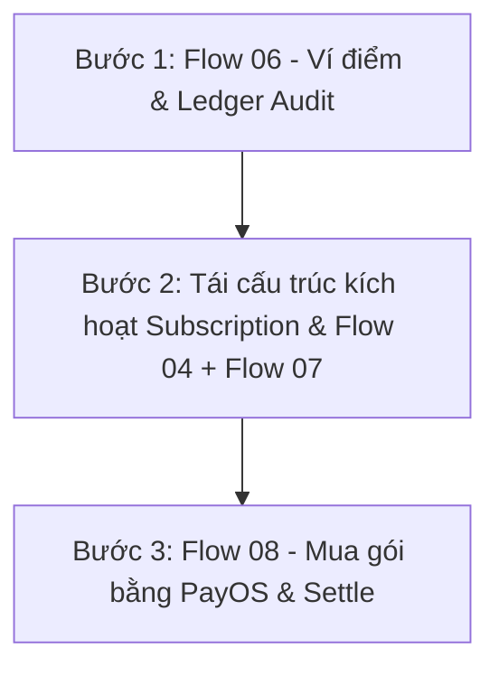

# TÀI LIỆU BÀN GIAO BACKEND: TỔNG QUAN ĐÃ LÀM & HƯỚNG DẪN TRIỂN KHAI FLOW 04, 06, 07, 08

> **Dành cho:** Backend Developer tiếp nhận phát triển các module Subscription, Điểm thưởng (Reward Points) và Thanh toán PayOS.  
> **Repository:** `PrintHub_3D` (Spring Boot 3, Java 21, Spring Data JPA, PayOS SDK, JUnit 5/Mockito).  
> **Tài liệu đặc tả chi tiết đi kèm:**  
> - `FLOW_FIX_01_CUSTOM_PRICING_PAYMENT.md` *(Đã hoàn tất)*  
> - `FLOW_FIX_04_ADMIN_SUBSCRIPTION_GIFT_FEEDBACK.md`  
> - `FLOW_FIX_06_REWARD_POINTS_LIFECYCLE.md`  
> - `FLOW_FIX_07_SUBSCRIPTION_POINT_REDEMPTION.md`  
> - `FLOW_FIX_08_SUBSCRIPTION_CASH_PURCHASE.md`  

---

## 1. TỔNG QUAN: NHỮNG GÌ BE ĐÃ LÀM KHI BẠN PULL REPO VỀ

Trước khi bạn nhận task, **Flow 01 (Sửa giá custom và khóa thanh toán an toàn)** đã được triển khai, kiểm thử và commit vào backend. Bạn **không cần** sửa lại những phần này, nhưng **phải nắm rõ** để tránh làm vỡ các bất biến nghiệp vụ khi viết tiếp code.

### 1.1. Các commit đã thực hiện trên nhánh BE
* **Commit `1c6fae5`**: `[FEAT] enforce custom pricing restrictions in checkout and payment processes`  
* **Commit `39f9012`**: `[TEST] add unit tests for custom pricing and payment restrictions flow 01`  
* *(Các commit trước đó gồm: Hoàn thiện CRUD giỏ hàng, CheckoutOrder entity, hủy giỏ hàng an toàn, OTP resend).*

### 1.2. Chi tiết logic cốt lõi đã được khóa chặt ở Flow 01
1. **Giỏ hàng (`CartServiceImpl.java`)**:
   - Không cho phép FE hoặc client tự gửi `customPrice` để lưu vào DB.
   - Mọi item custom khi thêm/cập nhật giỏ đều bị ép `customPrice = null`. Giá chỉ được sinh ra từ quy trình báo giá chính thức của Admin xưởng sau khi thẩm định file 3D.
2. **Tạo đơn thanh toán (`CheckoutOrderServiceImpl.java`)**:
   - Khi tạo `CheckoutOrder` từ giỏ hàng, các đơn in `CustomOrder` con luôn khởi tạo ở trạng thái `REQUESTED` với `quotedPrice = null`.
   - Nếu đơn hàng có chứa bất kỳ món in custom nào, trạng thái của `CheckoutOrder` luôn là `PENDING_QUOTE`.
   - Tiền tổng `totalAmount` lúc này chỉ tính sản phẩm có sẵn (Marketplace) + phí vận chuyển cố định (30.000 VNĐ).
3. **Thanh toán & Cổng PayOS (`PaymentServiceImpl.java`)**:
   - **Tạo link thanh toán (`createPaymentLink`)**: Bắt buộc `CheckoutOrder` phải ở trạng thái `CONFIRMED`. Nếu đơn còn custom order con chưa được khách đồng ý giá (`status != 'ACCEPTED'` và `status != 'PAID'`), hệ thống **từ chối ném lỗi ngay lập tức**.
   - **Quyết toán thanh toán (`settle`)**: Khi webhook PayOS hoặc verify thanh toán báo `PAID`, chỉ đánh dấu các `Order` chưa bị `CANCELLED`, và chỉ đánh dấu `PAID` cho các `CustomOrder` đã được duyệt báo giá (`ACCEPTED` và có `quotedPrice != null`).
4. **Bộ kiểm thử tự động (Unit Test Regression)**:
   - File test: `src/test/java/com/fpt/printhub_3d/service/CustomPricingAndPaymentFlowTest.java`.
   - Chạy lệnh: `mvn test -Dtest=CustomPricingAndPaymentFlowTest` → **5/5 tests PASSED**.

---

## 2. HIỆN TRẠNG MÃ NGUỒN CỦA CÁC FLOW BẠN SẼ LÀM (4, 6, 7, 8)

Các entity, repository và controller cơ bản đã có trong source code. Tuy nhiên, logic nghiệp vụ hiện tại đang còn các "lỗ hổng" (gaps) mà bạn cần giải quyết:

| Flow | Module / File liên quan chính | Hiện trạng code có sẵn | Lỗ hổng cần bạn giải quyết |
| :--- | :--- | :--- | :--- |
| **Flow 04** | `UserSubscriptionController.java`<br>`UserSubscriptionServiceImpl.java` | Đã có API `@PostMapping("/gift")` bảo vệ quyền ADMIN, gọi `processSubscriptionActivation`. | 1. Chưa có `requestId` / Idempotency key chống bấm trùng / retry.<br>2. `processSubscriptionActivation` đang hardcode `durationDays = 30` thay vì lấy từ cấu hình `plan.getDurationDays()`.<br>3. Nếu user đang có gói A (loại CUSTOMER), admin tặng gói B (cũng loại CUSTOMER), code hiện tại chỉ tìm theo type rồi cộng ngày cho gói A, **bỏ qua gói B**! |
| **Flow 06** | `PointWallet.java`, `PointTransaction.java`<br>`OrderServiceImpl.completeRewards`<br>`ReviewServiceImpl.rewardPointsForReview` | Entity ví điểm & lịch sử điểm đã có. `OrderServiceImpl.completeRewards` đã tính điểm mua hàng cho đơn marketplace (`floor(totalAmount / 10000)`). | 1. Đơn in 3D custom (`CustomOrder`) khi `COMPLETED` chưa được cộng điểm mua hàng.<br>2. `ReviewServiceImpl.rewardPointsForReview` cộng 20 điểm trực tiếp vào `wallet.balance` nhưng **KHÔNG ghi bản ghi nào vào `PointTransaction`** (mất vết ledger audit).<br>3. Chưa dùng Pessimistic Lock khi cập nhật ví điểm (`findLockedByUserId`), dễ bị race condition khi nhiều event xảy ra cùng lúc. |
| **Flow 07** | `UserSubscriptionServiceImpl.redeemSubscription`<br>`PointWalletRepository.java` | Đã có API `@PostMapping("/redeem")`, kiểm tra điểm và trừ số dư ví, gọi `processSubscriptionActivation`. | 1. Chưa lock ví điểm an toàn khi trừ điểm.<br>2. Chưa xử lý xung đột gói: Nếu đang dùng gói A mà đổi điểm lấy gói B khác `planId`, code hiện tại lại gia hạn gói A thay vì cấp gói B. Cần trả mã lỗi `ACTIVE_PLAN_CONFLICT` nếu không cùng gói.<br>3. Chưa kiểm tra cờ `allowPointRedemption` hoặc `requiredPoints <= 0`. |
| **Flow 08** | `SubscriptionPlan.java`<br>`PaymentServiceImpl.java`<br>`Payment.java` | `SubscriptionPlan` đã có trường `price`. `PaymentServiceImpl` đã tích hợp PayOS nhưng chỉ hỗ trợ `ORDER`, `CUSTOM_ORDER`, `CHECKOUT_ORDER`. | 1. Chưa có đối tượng lưu đơn mua gói (`SubscriptionPurchase` hoặc Payment target loại SUBSCRIPTION).<br>2. Chưa có API tạo link PayOS mua gói hội viên.<br>3. Sau khi thanh toán PayOS thành công (`settle`), chưa có nhánh kích hoạt gói dịch vụ.<br>4. **QUAN TRỌNG:** Phải đảm bảo mua gói bằng tiền **KHÔNG ĐƯỢC CỘNG ĐIỂM THƯỞNG** mua hàng để chống lỗ hổng vòng lặp tiền → điểm → đổi gói. |

---

## 3. LỘ TRÌNH THỰC HIỆN KHUYẾN NGHỊ CHO BACKEND DEV

Để tránh sửa đi sửa lại các hàm dùng chung, bạn nên làm theo thứ tự sau:



### Bước 1: Hoàn thiện Flow 06 (Ví điểm, Pessimistic Lock & Audit Ledger)
1. Trong `PointWalletRepository`: Thêm query khóa bi quan (Pessimistic Write Lock) để bảo vệ số dư:
   ```java
   @Lock(LockModeType.PESSIMISTIC_WRITE)
   @Query("SELECT w FROM PointWallet w WHERE w.userId = :userId")
   Optional<PointWallet> findByUserIdForUpdate(@Param("userId") UUID userId);
   ```
2. Trong `OrderServiceImpl` và `CustomOrderServiceImpl`:
   - Chuẩn hóa việc cộng điểm mua hàng: Khi đơn chuyển sang `COMPLETED` và đã thanh toán đủ (`PAID`), gọi tính điểm theo công thức `floor(totalAmount / 10000)`.
   - Bổ sung cộng điểm cho `CustomOrder` (tương tự như `Order`).
   - Đảm bảo tính Idempotent: Kiểm tra cờ `rewardProcessed == true` trước khi cộng để không cộng 2 lần.
3. Trong `ReviewServiceImpl.rewardPointsForReview`:
   - Bổ sung ghi bản ghi `PointTransaction` với `PointTransactionType.EARN`, mô tả "Thưởng điểm đánh giá sản phẩm có hình ảnh".

### Bước 2: Tái cấu trúc kích hoạt gói & Triển khai Flow 04 + Flow 07
1. Sửa hàm private `processSubscriptionActivation(User user, SubscriptionPlan plan)` trong `UserSubscriptionServiceImpl`:
   - Lấy thời hạn thực tế: `int durationDays = (plan.getDurationDays() != null && plan.getDurationDays() > 0) ? plan.getDurationDays() : 30;`.
   - **Xử lý xung đột gói**:
     - Tìm subscription đang active của user.
     - Nếu user đang có gói active cùng `plan.getId()`: Cho phép gia hạn (`endDate = currentEndDate.plusDays(durationDays)`).
     - Nếu user đang có gói active nhưng **khác `plan.getId()`**: Ném ngoại lệ `ApiException(CommonErrorCode.BAD_REQUEST, "ACTIVE_PLAN_CONFLICT: Người dùng đang có gói hội viên khác còn hiệu lực.")`.
2. **Hoàn thiện Flow 04 (Admin Gift)**:
   - Thêm `requestId` vào `GiftSubscriptionRequestDTO`.
   - Dùng cache/bảng lưu `requestId` đã xử lý để tránh admin double-click tặng 2 lần.
   - Trả về đúng `UserSubscriptionResponseDTO` chứa hạn dùng thực tế sau khi commit.
3. **Hoàn thiện Flow 07 (Redeem bằng điểm)**:
   - Gọi `pointWalletRepository.findByUserIdForUpdate(userId)` để trừ điểm an toàn.
   - Ném ngoại lệ nếu gói có `requiredPoints == null || requiredPoints <= 0` hoặc `plan.getIsActive() == false`.
   - Ghi `PointTransaction` loại `REDEEM`, trừ ví và gọi hàm kích hoạt trong cùng một `@Transactional`.

### Bước 3: Hoàn thiện Flow 08 (Mua Subscription bằng tiền qua PayOS)
1. Tạo entity / model `SubscriptionPurchase` (hoặc định nghĩa loại giao dịch `SUBSCRIPTION` trong `Payment`):
   - Lưu: `id`, `user`, `plan`, `amount`, `paymentStatus` (`PENDING`, `PAID`, `CANCELLED`), `createdAt`.
2. Mở rộng `PaymentServiceImpl`:
   - Thêm nhánh tạo link PayOS cho subscription: Nhận `planId`, lấy giá snapshot từ `SubscriptionPlan.price`, tạo `SubscriptionPurchase` và gọi `payOS.createPaymentLink(...)`.
   - Trong hàm `settle(...)`: Khi PayOS báo thành công, tìm `SubscriptionPurchase` tương ứng, cập nhật trạng thái `PAID` và gọi kích hoạt gói hội viên cho user.
   - **CẢNH BÁO QUAN TRỌNG:** Tuyệt đối **KHÔNG** gọi hàm cộng thưởng điểm `completeRewards` cho giao dịch mua gói hội viên!

---

## 4. QUY TẮC PHÁT TRIỂN & CHẠY THỬ NGHIỆM

1. **Môi trường yêu cầu**:
   - Java 21, Apache Maven 3.9+.
   - Cơ sở dữ liệu cấu hình trong file `.env` hoặc `.env.local`.
2. **Kiểm tra hồi quy (Regression Test)**:
   - Trước và sau khi viết code mới, hãy chạy lệnh:
     ```bash
     mvn test -Dtest=CustomPricingAndPaymentFlowTest
     ```
   - Đảm bảo 5 test case hiện tại của Flow 01 luôn đạt **BUILD SUCCESS**.
3. **Viết test case mới**:
   - Viết các test case tương tự trong thư mục `src/test/java/com/fpt/printhub_3d/service/`:
     - `RewardPointsLifecycleTest.java` (cho Flow 06).
     - `UserSubscriptionServiceTest.java` (cho Flow 04, 07, 08).
4. **Không làm vỡ luồng Frontend**:
   - Giữ nguyên các DTO response cơ bản: `UserSubscriptionResponseDTO`, `UserSubscriptionSummaryDTO`, `RewardCompletionResponseDTO`.
   - Nếu bổ sung trường mới trong response, hãy đặt giá trị tương thích ngược (nullable hoặc có default value).
